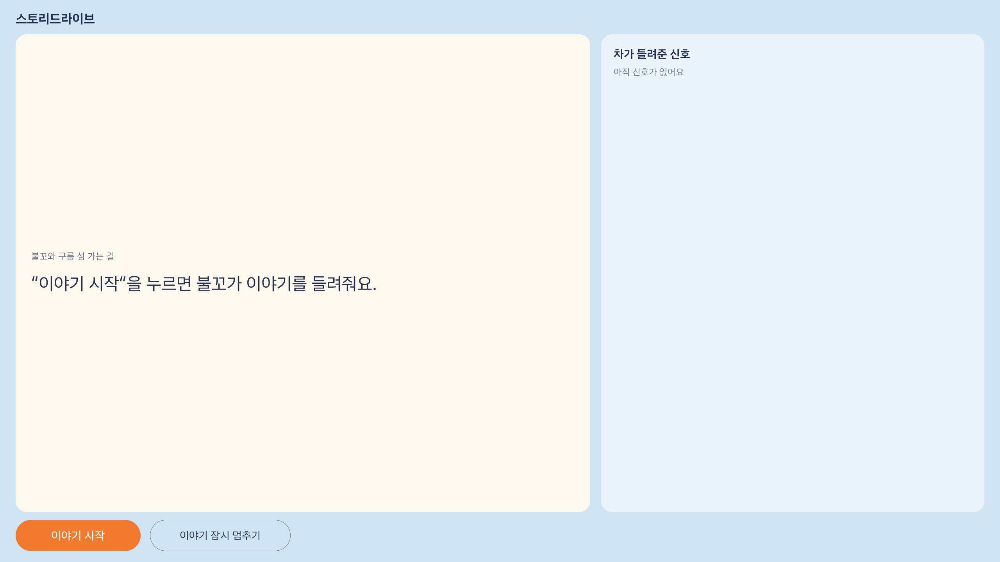

# 스토리드라이브 (StoryDrive)



> 현재 진행 상황: M0~M3 완료(차량 신호 구독, Pleos TTS 음성, 사건 기반 이야기 재생). APK는 [Releases](https://github.com/ZestfulPulse/storydrive/releases)에 추가 예정

뒷좌석 아이를 위한 Pleos Connect 차량용 이야기 앱 시제품입니다.
현대자동차그룹 차량용 앱 개발 공모전 출품작입니다.

## 핵심 아이디어

**차가 움직이면 이야기가 바뀝니다.**
브레이크를 밟으면 이야기 속 꼬마 용 "불꼬"도 구름 위에서 쉬고, 방향지시등을 켜면 이야기 속 길도 같은 방향으로 꺾이고, 와이퍼가 움직이면 이야기 나라에도 비가 내립니다.
운전자는 뒤를 돌아보거나 화면을 만지지 않아도 되고, 아이는 화면 대신 차의 움직임과 함께 흘러가는 이야기에 몰입합니다.

음성 비서는 사람이 말해야 차가 움직입니다. 스토리드라이브는 아무도 말하지 않아도, 차의 움직임이 이야기를 움직입니다.

## 동작 방식

```
차량 신호 ──▶ ① 신호 수집 ──▶ ② 사건 변환 ──▶ ③ 이야기 엔진 ──▶ ④ 안전 장치 ──▶ ⑤ 음성 출력
(Vehicle SDK)   capability 확인   STOP, TURN_LEFT    장면 블록 선택    문 열림·벨트 풀림     Pleos TTS
                후 구독            RAIN_ON, WARM 등   중복 무시·대기열   즉시 멈춤            (ON_DEVICE)
```

| 단계 | 구현 | 하는 일 |
|---|---|---|
| ① 신호 수집 | `VehicleSignalMonitor.kt` | 신호마다 capability로 지원 여부를 확인한 뒤 구독. 지원되지 않는 신호는 "이 차량에서는 사용 안 함"으로 표시하고 제외 |
| ② 사건 변환 | `EventDetector` | 신호 변화를 사건 코드로 변환. 첫 수신값은 기준값으로만 저장 |
| ③ 이야기 엔진 | `StoryDirector`, `SceneBook` | 사건에 맞는 장면 문장 선택(직전 문장 반복 방지), 같은 사건 8초 내 중복 무시, 25초 동안 사건이 없으면 이어지는 장면 |
| ④ 안전 장치 | `StoryDirector` | 문 열림·안전벨트 풀림은 우선 처리: 재생 중인 문장을 즉시 끊고 안내 후 일시 정지, 원상 복구되면 이어 가기 |
| ⑤ 음성 출력 | `Narrator`, `KoreanSpeaker.kt` | 대기열 최대 2문장, 재생 중 새 문장 금지, 끝 신호(onDone)를 받은 뒤 다음 문장, 끝 신호가 오지 않으면 예상 시간 타이머로 넘김 |

### 사건과 장면

| 사건 | 발생 조건 | 장면 예시 |
|---|---|---|
| `START` | "이야기 시작" 버튼 | "안녕, 대장, 부대장! 나는 꼬마 용 불꼬야…" |
| `STOP` | 브레이크를 밟음 | "어? 구름 신호등이 빨간색이야… 다 같이 하나, 둘, 셋!" |
| `GO` | 기어 D에서 브레이크를 뗌 | "초록불이다! 불꼬가 다시 하늘로 날아올라!" |
| `TURN_LEFT` / `TURN_RIGHT` | 방향지시등 켜짐 | "오른쪽 구름 굴로 꺾는다! 대장, 부대장, 꽉 잡아!" |
| `RAIN_ON` / `RAIN_OFF` | 앞 와이퍼 켜짐 / 꺼짐 | "어? 이야기 나라에도 비가 오기 시작했어…" |
| `WARM` | 시트 열선 켜짐 (뒷좌석 우선) | "불꼬가 후우, 따뜻한 숨을 불어 줄게…" |
| `DOOR_OPEN` | 문 열림 | 즉시 멈춤 → "잠깐 쉬는 시간!…" |
| `BELT_WARN` | 안전벨트 체결 → 풀림 | 즉시 멈춤 → "불꼬가 날아가려면 모두 안전벨트를 꼭 매야 해." |
| `RESUME` | 모든 문 닫힘, 벨트 정상 | "다시 출발할 준비 됐지?…" |
| `IDLE` | 25초 동안 사건 없음 | 이어지는 이야기 |

장면 문장은 `app/src/main/assets/scenes.json`에 있습니다. 아이 호칭(`{아이1}`, `{아이2}`)은 앱 안에서만 채우며, 시제품에서는 "대장", "부대장"을 씁니다.

## 사용 SDK

| SDK | 버전 | 용도 |
|---|---|---|
| Pleos Vehicle SDK | `ai.pleos.playground:Vehicle:2.3.2` | 차량 상태 구독 |
| Pleos TextToSpeech SDK | `ai.pleos.playground:TextToSpeech:3.3.1` | 한국어 음성 합성, **ON_DEVICE 모드만 사용** (서버 모드·키 미사용) |

| 신호 | Vehicle SDK API | 권한 |
|---|---|---|
| 브레이크 페달 | `getBrake().registerBrakePedalStatus` | `CAR_DRIVE` |
| 기어 | `getGear().registerGearSelection` | `CAR_DRIVE` |
| 방향지시등 | `getTurnSignal().registerTurnSignalState` | `CAR_LIGHTS` |
| 와이퍼 | `getWiper().registerWiperState` | `CAR_WINDOWS` |
| 시트 열선 | `getSeat().registerHvacSeatTemperature` | `CAR_SEATS` |
| 도어 | `getDoor().registerDoorPosition` | `CAR_DOORS` |
| 안전벨트 체결 | `getSeat().registerSeatBeltBuckledState` | `CAR_SEATS` |
| 안전벨트 경고 | `getSafety().registerSeatBeltNotBuckledWarning` | `CAR_SAFETY` |

권한은 모두 `pleos.car.permission.*`(SDK 표기 기준)이며, 음성 합성은 `pleos.car.permission.TTS_SERVICE`를 씁니다. 신호별 상세(capability 함수, 콜백, 에뮬레이터 지원 상태)는 [docs/SDK_NOTES.md](docs/SDK_NOTES.md)에 있습니다.

## 실행 방법

### 1. Pleos Connect 에뮬레이터 준비
공식 가이드: [Pleos Connect Emulator 설치 및 실행](https://document.pleos.ai/docs/connect/guide/getting-started/application-development/setup-connect-sdk-emulator)
- 시스템 이미지: Pleos Connect v2.1.0 APIs (API 34)
- AVD 설정: Default boot **Cold** (Quick boot에서는 차량 신호를 쓸 수 없음), RAM 4GB

### 2-A. APK로 설치
[Releases](https://github.com/ZestfulPulse/storydrive/releases)에서 APK를 내려받아, 에뮬레이터를 켠 상태에서:
```
adb install -r storydrive.apk
```

### 2-B. 소스에서 빌드
요구 사항: Android Studio(내장 JDK 17 이상), Gradle 8.0 이상, minSdk 28
```
git clone https://github.com/ZestfulPulse/storydrive.git
cd storydrive
./gradlew installDebug
```
Pleos SDK는 `settings.gradle.kts`에 등록된 Pleos Maven 저장소(`nexus-playground.pleos.ai`)에서 받습니다.

## 시연 방법 (버추얼 콘솔)

1. `adb forward tcp:8088 tcp:8088` 후 브라우저에서 http://127.0.0.1:8088/ 열기
2. 앱에서 **이야기 시작** (기어 P 상태)
3. 아래처럼 신호를 바꾸면 해당 장면이 들립니다. 한 장면이 끝난 뒤 다음 조작을 하세요.

| 콘솔 조작 | 들리는 장면 |
|---|---|
| 메인 화면 **BRAKE** 눌렀다 떼기 | 정차 장면 |
| Emulation Controls > **Turn Signal State** > Blink left / right | 회전 장면 |
| 메인 화면 **FRONT WIPER** Low → Off | 비 시작 → 비 그침 장면 |
| Emulation Controls > **Seat Temperature** > Driver > H1 | 용의 숨결 장면 |
| Emulation Controls > **Door Position** > Rear left > Open → Close | 즉시 멈춤과 쉬는 시간 안내 → 다시 출발 장면 |

화면 오른쪽 "차가 들려준 신호" 목록에 반영된 사건이 표시됩니다.

## 에뮬레이터 제약과 한계

- **시트 열선**: 버추얼 콘솔은 앞좌석(Driver/Passenger) 열선만 바꿀 수 있습니다. 그래서 시연은 앞좌석 열선으로 대체하며, 실제 제품은 뒷좌석 열선을 기준으로 동작합니다(앱은 뒷좌석을 우선하고, 앞좌석 열선도 같은 사건으로 인정).
- **안전벨트**: 에뮬레이터에서 벨트 상태를 바꿀 수 없고 벨트 경고 신호도 지원되지 않아, 벨트 사건 판단은 단위 테스트로 검증합니다. 앱은 실제 벨트 체결 상태를 구독합니다.
- **와이퍼**: SDK에서 켜짐/꺼짐만 알 수 있어 비 시작/그침 두 가지 사건만 사용합니다.
- **음성 합성**: 안드로이드 표준 TextToSpeech는 Pleos 에뮬레이터에서 엔진을 찾지 못해, Pleos TextToSpeech SDK(ON_DEVICE)를 사용합니다. Pleos Playground 콘솔에는 이 SDK가 "준비 중"으로 표시되어 있어, 사용 불가 시 미리 녹음한 음성 파일로 전환할 계획입니다(아직 구현 전).
- **오디오 잡음**: 일부 PC에서 에뮬레이터 재생 중 잡음이 들릴 수 있습니다. 시스템 알림음에서도 같은 현상이 나타나 에뮬레이터·호스트 환경 문제로 판단했습니다.
- **기어 API**: 사용 중인 기어 API는 deprecated 상태이며, 출시 전 GEAR_SELECTION 전환을 검토합니다.

## 개인정보와 보안

- 아이 목소리를 녹음하거나 저장하지 않습니다.
- 이 시제품은 외부 서버와 통신하지 않습니다. 이야기는 앱에 들어 있는 장면 블록으로 만듭니다.
- 저장소에 API 키, 토큰, 개인 정보가 없습니다.
- 향후 외부 AI로 장면을 생성할 경우에도 공모전 운영사무국 안내에 따라 비식별 짧은 텍스트(예: "정차", "우회전")만 HTTPS로 보내고, 아이 이름은 차 안에서만 문장에 채웁니다.

## 테스트

```
./gradlew testDebugUnitTest
```
사건 변환, 8초 중복 무시, 안전 사건 우선 처리, 대기열 최대 2개, 재생 중 새 문장 금지, 끝 신호 기준 다음 문장, 예상 시간 타이머, 끝 신호 중복 처리 방지, 벨트 체결 → 풀림 판단, 열선 뒷좌석 우선, 호칭 채우기를 단위 테스트로 검증합니다.

## 문서

- [docs/SDK_NOTES.md](docs/SDK_NOTES.md): SDK 사용 기록, 에뮬레이터 확인 결과
- [docs/WORK_ORDER.md](docs/WORK_ORDER.md): 시제품 작업지시서, 마일스톤과 검증 기준
- [docs/NEXT.md](docs/NEXT.md): 다음 작업
